# Отчёт по лабораторной работе №5
## «Проектирование модели управления версиями ПО, конфигурациями и непрерывной поставкой»

**Дисциплина:** Непрерывное интегрирование и сборка программного обеспечения  
**Студент:** Бельский Тимофей Дмитриевич  
**Группа:** 11а  
**Год:** 2026  
**GitHub:** [pipa53](https://github.com/pipa53)

---

## Введение

Работа посвящена средствам автоматизации: Terraform для описания
инфраструктуры кодом и Ansible для настройки узлов. Практический
результат — стенд, в котором Terraform поднимает kind-кластер,
Ansible разворачивает в нём приложение из ЛР1, а распределение
сервисов по нодам подтверждается выводом kubectl.

---

## Задание 1. Основы управления конфигурацией инфраструктуры с Terraform

### Что требовалось

Изучить официальное руководство Terraform Tutorial и выполнить все семь
руководств трека Get Started - Docker, продемонстрировав каждое из них.

### Что было сделано

Установлен Terraform v1.16.6 (winget). Подготовлены три
файла: `main.tf` (образ `nginx:1.27-alpine` и контейнер из него,
провайдер `kreuzwerker/docker ~> 4.2.0`), `variables.tf` (переменная
`web_name`) и `outputs.tf` (выходы `web_container_id`, `web_image_id`).

> **Особенность окружения.** Прямой доступ к `registry.terraform.io`
> из Беларуси ограничен: сервер вместо описания провайдера отдаёт
> страницу «Content is not available in your region», и `terraform init`
> завершается ошибкой `Invalid provider registry host`. Обходной путь —
> VPN: с ним реестр отвечает корректно, провайдеры `kreuzwerker/docker`
> и `tehcyx/kind` устанавливаются штатно. Альтернатива — зеркало
> `registry.opentofu.org`, но проверка GPG-подписи kind-провайдера
> там не проходит, поэтому в работе применялся VPN.

Пройдены все семь руководств:

1. **Концепции IaC** — декларативный язык описания, провайдеры,
   файл состояния, совместная работа через удалённый backend.
2. **Установка** — `terraform --version` подтвердил готовность CLI.
3. **Сборка инфраструктуры** — `init` установил провайдер версии
   4.2.0 и создал lock-файл, `fmt` и `validate` подтвердили корректность
   конфигурации, `apply` создал два ресурса. Контейнер с nginx отвечает
   на `localhost:8090`, `show` и `state list` показали содержимое
   состояния.
4. **Изменение инфраструктуры** — внешний порт переведён с 8090 на 8091:
   план показал `-/+ destroy and then create replacement` с пометкой
   `forces replacement`, контейнер был пересоздан, новый порт заработал.
5. **Уничтожение инфраструктуры** — план с действием `- destroy`:
   контейнер и образ удаляются, публикация порта `8091` снимается.
6. **Входные переменные** — имя вынесено в `var.web_name`, значение
   подменено ключом `-var "web_name=AnotherWebName"`.
7. **Выходные значения** — `terraform output` вывел `web_container_id`
   и `web_image_id` из состояния.

### Скриншоты

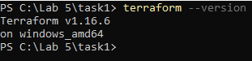

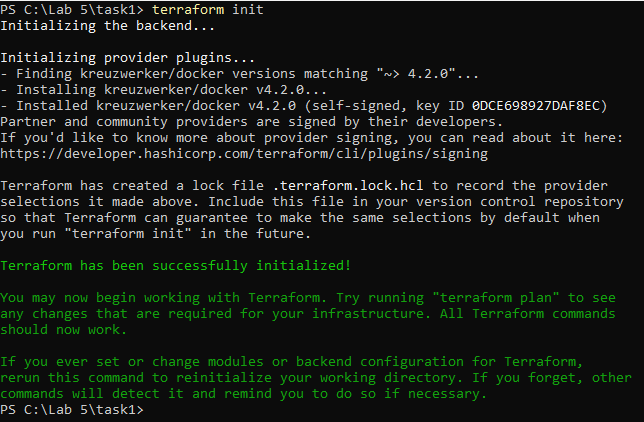

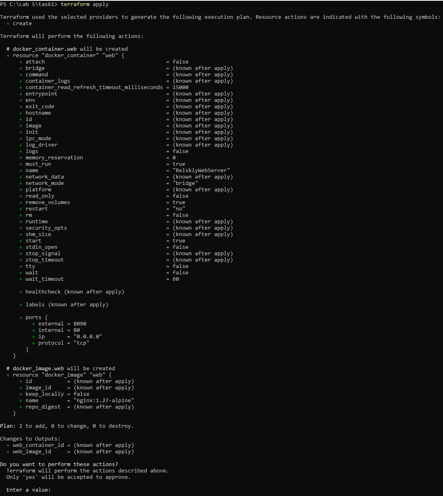

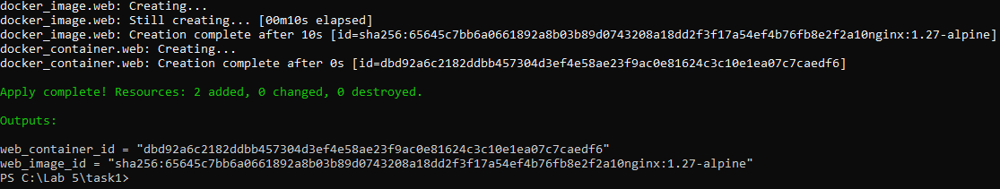

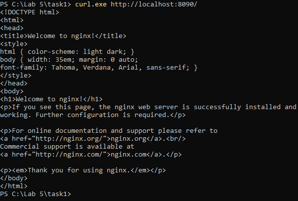

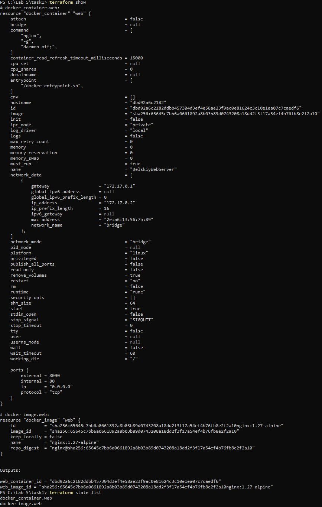

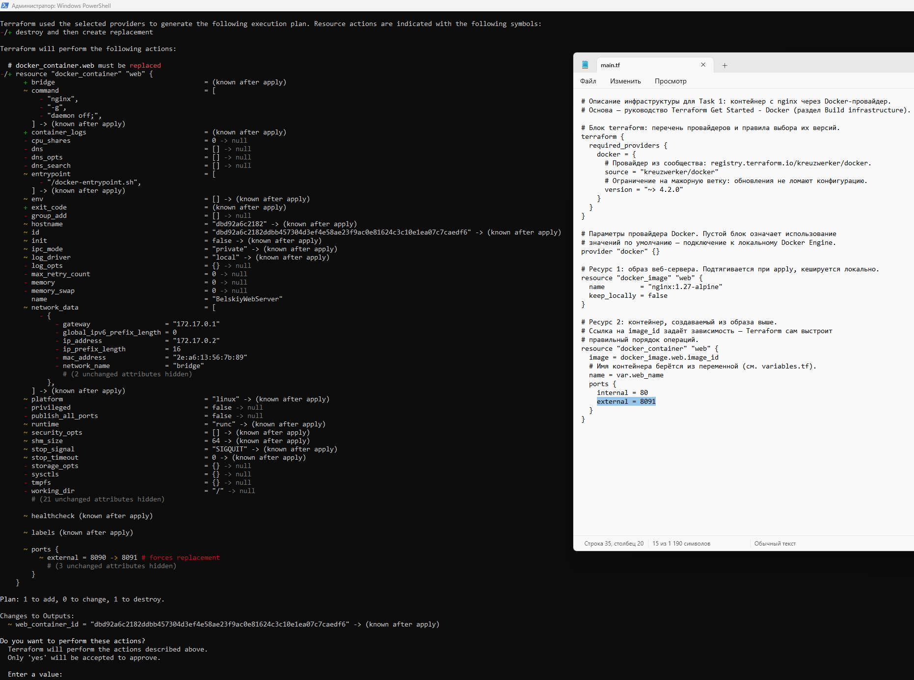

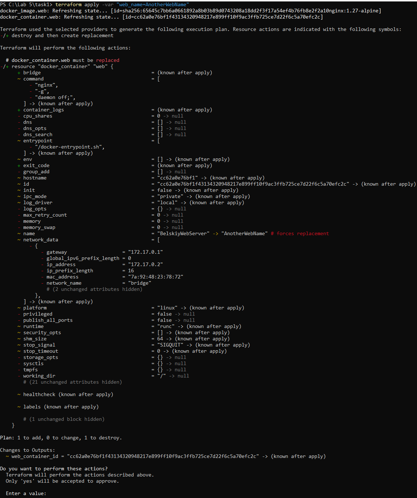

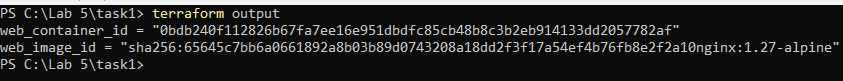

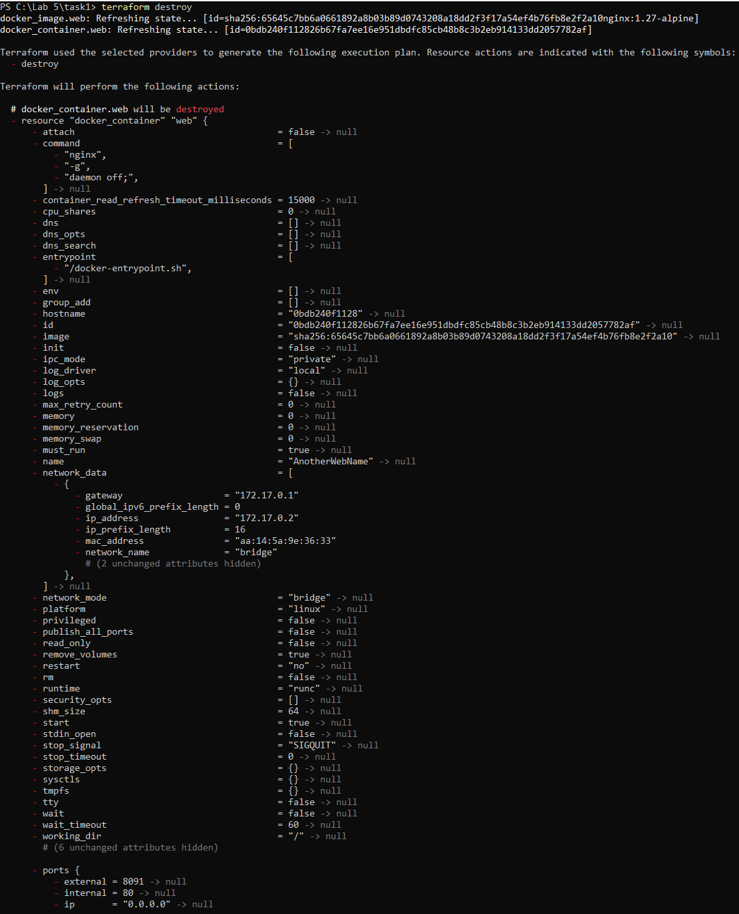

### Выводы

- Terraform берёт на себя рутинные операции: сначала показывает
  план-дифф и лишь затем применяет изменения, поэтому результат
  каждой операции предсказуем.
- Файл состояния — источник истины: именно по нему определяется,
  что нужно создать, изменить или удалить в следующий раз.
- Некоторые правки (в частности смена порта у контейнера) Docker
  выполнить «на месте» не позволяет — Terraform показывает это
  в плане и пересоздаёт ресурс самостоятельно.
- Переменные и выходные значения превращают разовый конфиг
  в переиспользуемый модуль.

---

## Задание 2. Управление конфигурацией серверов с помощью Ansible

### Что требовалось

1. Изучить статьи How To Set Up Ansible Inventories и How To Manage
   Multiple Servers with Ansible Ad Hoc Commands.
2. Изучить документацию Using Ansible command line tools.
3. Продемонстрировать подключение к узлам и установку пакета командами.
4. Изучить статью How To Write Ansible Playbooks и документацию
   Using Ansible playbooks.
5. Настроить конфигурации в виде playbook и продемонстрировать их.

### Что было сделано

Виртуальных машин, создававшихся в ЛР4, здесь нет — там применялся
kind внутри Docker, поэтому управляемым узлом служит локальная машина
WSL-Ubuntu с подключением `connection=local`, без SSH.

Установлен Ansible 13.1.0 (core 2.20.1). Подготовлены `inventory.ini`
(группа `nodes` с единственным хостом `localhost`) и `setup.yaml`
(два плея: инсталляция пакетов `tree` и `htop`, затем создание файла
`/etc/motd.custom`).

Выполнено:

- `ansible --version` — состав и версии компонентов;
- `ansible-inventory -i inventory.ini --list` — состав группы и
  переменных;
- `ansible nodes -i inventory.ini -m ping` — проверка связи с узлом
  (ответ `pong`);
- `ansible nodes -i inventory.ini -m ansible.builtin.apt -a "name=tree
  state=present"` — разовая установка пакета;
- `ansible-playbook -i inventory.ini setup.yaml` — прогон плейбука:
  `ok=5 failed=0`, повторный прогон дал `changed=0`, то есть
  идемпотентность;
- `cat /etc/motd.custom` и `htop --version` — проверка результата.

### Скриншоты

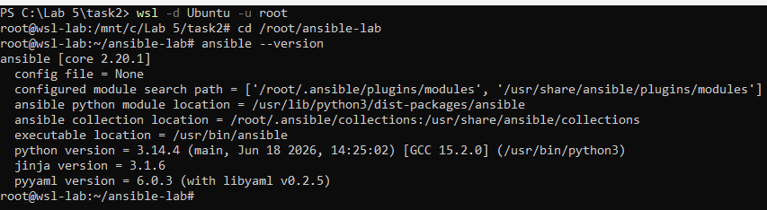

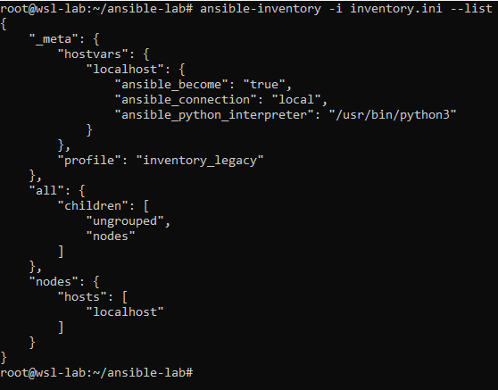

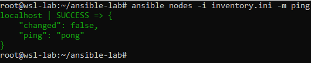

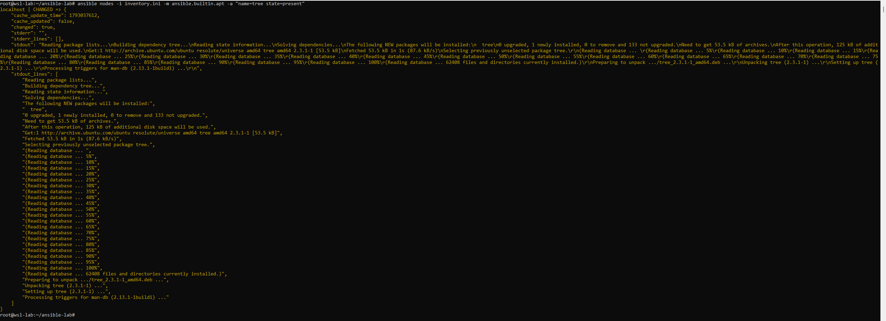

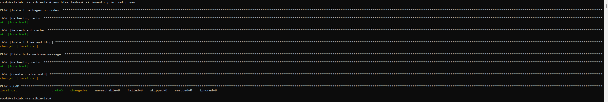

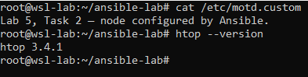

### Выводы

- Опись узлов отделяет «чем управляем» от «что делаем»: одни и те же
  команды применимы к любому набору хостов.
- Разовые операции удобно выполнять ad-hoc, повторяемые сценарии —
  оформлять в playbook, который приводит узлы к заданному состоянию.
- Повторный запуск плейбука ничего не меняет (`changed=0`) — это
  и есть идемпотентность Ansible.

---

## Задание 3. Создание кластера с помощью Terraform и Ansible локально

### Что требовалось

Развернуть в кластере Kubernetes проект из задания 5 лабораторной
работы №1, показав размещение отдельных сервисов на разных нодах.
Обязательны Terraform, Ansible, Kubernetes и Docker.

### Что было сделано

Выбран второй вариант — kind с методом Docker-in-Docker: он не требует
подготовки виртуальных машин и полностью укладывается в условие.

**Terraform** описал kind-кластер `k8s-lab` (один control-plane и два
worker, провайдер `tehcyx/kind 0.11.0`). Кластер создан одной командой
`terraform apply`, kubectl переключился на контекст `kind-k8s-lab`.
Файл kubeconfig провайдер сохраняет отдельно — в `C:/k8s-lab/kubeconfig`,
чтобы не затрагивать кластеры других лабораторных работ.

**Docker** собрал образы из проекта ЛР1: `warden-api:lab5`
(каталог `app`) и `warden-migrator:lab5` (каталог `liquibase`), затем
загрузил их в ноды командой `kind load docker-image`.

**Kubernetes** — восемь манифестов: StatefulSet PostgreSQL с
собственным томом и `nodeSelector` на `k8s-lab-worker2`, Service
`postgres`, Job миграций `migrator`, Deployment `api` (две реплики)
с Service `api`, ConfigMap с конфигурацией nginx, Deployment `gateway`
и его NodePort Service.

**Ansible** разложил всё в правильном порядке (БД → миграции →
приложение → шлюз) с ожиданием готовности на каждом шаге. Плейбук
завершился с `ok=10 failed=0` и напечатал размещение: `api` (две
реплики) и `gateway` — на `k8s-lab-worker`, `postgres-0` — на
`k8s-lab-worker2`, Job `migrator` отработал.

Проверка работы приложения выполнена через `kubectl port-forward
svc/gateway 8080:80` (в WSL-Ubuntu, где настроен kubectl) и
`curl.exe http://localhost:8080/wardens` (в PowerShell) — сервис вернул
список надзирателей из базы, заполненной миграциями.
Завершено `terraform destroy` — кластер удалён как обычный ресурс.

### Скриншоты

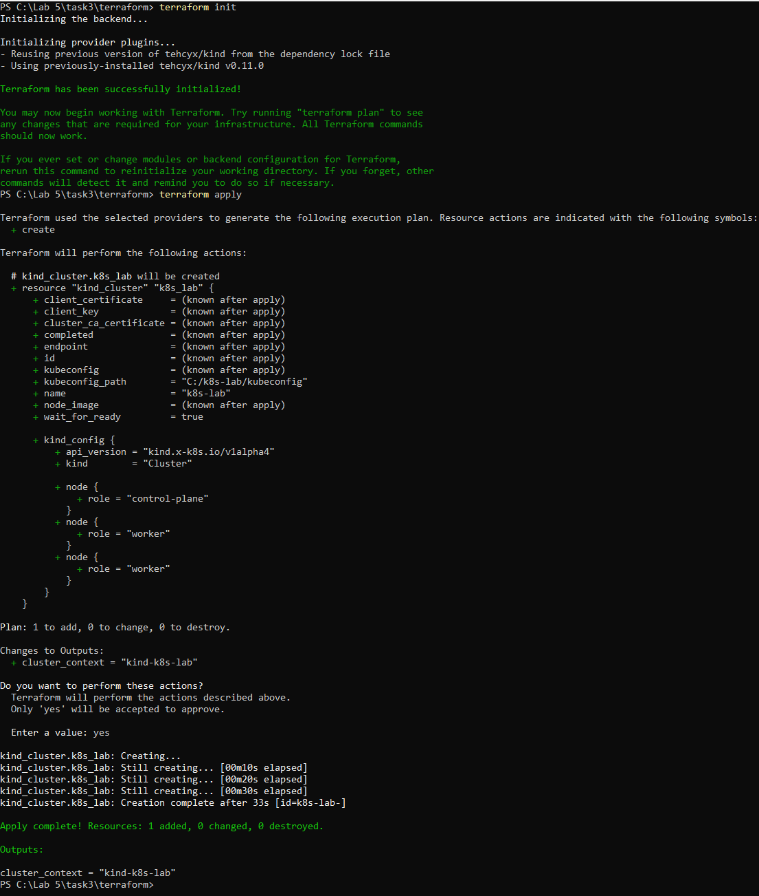

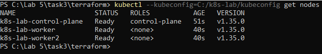

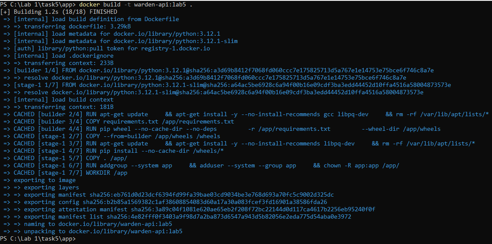

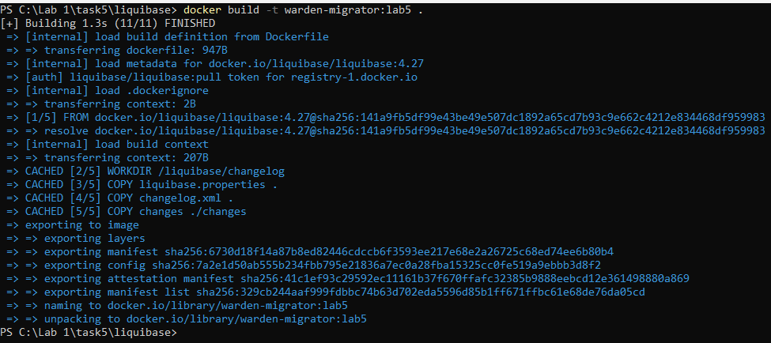

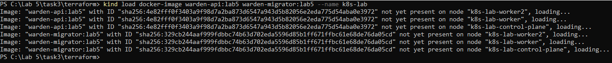

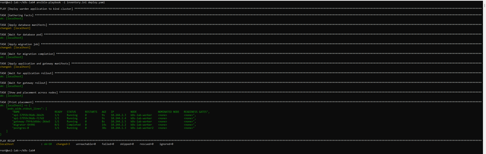

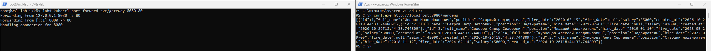

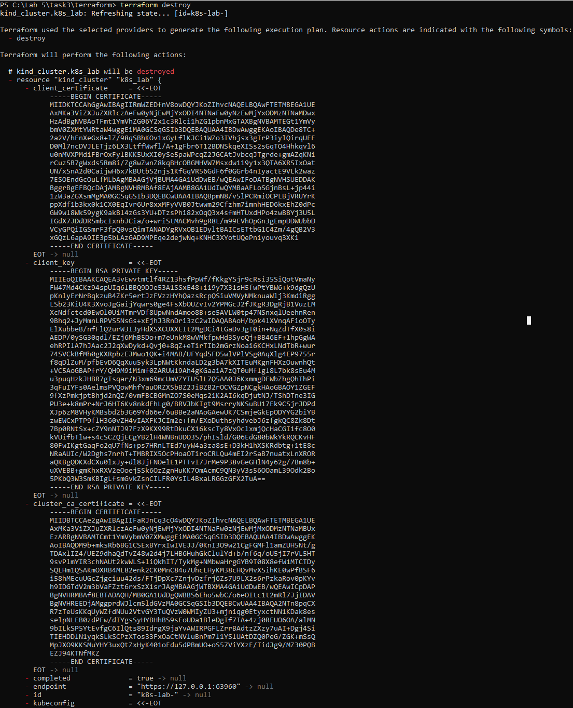

### Выводы

- Terraform оперирует кластером kind как обычным ресурсом: создание
  и удаление сводятся к одной команде, а состояние хранится в файле.
- Ansible удобен для оркестрации развёртывания: последовательность
  шагов и ожидание готовности гарантируют, что миграции пройдут
  до старта приложения, а база — до появления реплик.
- `nodeSelector` позволяет декларативно развести stateless-компоненты
  и базу данных по разным нодам.
- Одинаковые имена Service (`postgres`, `api`) разрешаются через
  кластерный DNS: в образе мигратора адрес базы в `liquibase.properties`
  заменён с `db` (имя из docker-compose ЛР1) на `postgres` — имя
  Service в кластере, остальные настройки переиспользованы без правок.

---

## Контрольные вопросы

### 1. Для каких задач применяется Ansible?

Ansible применяют для управления конфигурацией машин: установки и
удаления пакетов, раскладки файлов, управления сервисами, оркестрации
развёртываний и многократно повторяющихся операций на десятках узлов.
В настоящей работе через Ansible ставились пакеты на узел и
разворачивался стенд в Kubernetes.

### 2. Какие способы управления серверами применяются в Ansible?

Основные четыре: разовые ad-hoc команды; плейбуки — сценарии из
последовательности задач; роли — переиспользуемые наборы задач,
шаблонов и обработчиков; и централизованные решения вроде
Ansible AWX/Tower для запуска по расписанию и с веб-интерфейсом.
В работе применялись ad-hoc команды и плейбук.

### 3. Что входит в состав файла Ansible playbook?

YAML-файл со списком плейов. Плей задаёт имя (`name`), целевые узлы
(`hosts`), при необходимости `become` и список задач (`tasks`).
Задача включает имя и вызов модуля с аргументами, а через `notify`
может связываться с обработчиками. В работе playbook содержал два
плея и пять задач.

### 4. Что такое группы узлов (хостов) в Ansible?

Именованные наборы хостов из инвентаря, к которым обращаются
плейбуки и ad-hoc команды целиком. Группы бывают статическими и
динамическими, внутри группы действуют общие переменные. В работе
использовалась группа `nodes` с единственным хостом.

### 5. Как одной командой выполнить ping группы узлов?

```bash
ansible nodes -i inventory.ini -m ping
```

Каждый узел отвечает `pong`, что подтверждает доступность и
работоспособность Python на нём. Так проверялась связность перед
основными задачами.

### 6. Что такое роль Ansible?

Переиспользуемый пакет задач, шаблонов файлов, переменных и
обработчиков, разложенный по фиксированной структуре каталогов
(`tasks/`, `handlers/`, `templates/`, `vars/`, `defaults/`...). Роль
подключается одной строкой в плейбуке и позволяет одинаково
настраивать разные типы узлов. В работе роли не требовались.

### 7. Что такое файл инвентаризации Ansible и как он используется?

Файл со списком управляемых узлов, их принадлежностью к группам и
переменными; форматы INI и YAML. Указывается ключом `-i` во всех
командах — без него Ansible не знает, к каким хостам подключаться
и какими учётными данными пользоваться.

### 8. Что такое специальная (ad-hoc) команда Ansible?

Разовая операция, задаваемая прямо в командной строке, без
оформления в playbook: `ansible <группа> -m <модуль> -a "<аргументы>"`.
Применяется для проверок и точечных операций — например, ping
группы или установка одного пакета.

### 9. Как перезапустить службу с помощью Ansible?

Ad-hoc: `ansible nodes -m ansible.builtin.service -a
"name=nginx state=restarted" --become`. В playbook — задача с тем же
модулем, либо обработчик, срабатывающий по `notify` после изменения
конфигурации.

### 10. Что такое HashiCorp Terraform?

Инструмент для описания инфраструктуры кодом (IaC): конфигурация
пишется на HCL в файлах `.tf`, плагины-провайдеры создают реальные
ресурсы через API платформ. Работает циклом init → plan → apply →
destroy и хранит сведения об управляемых объектах в файле состояния.
В работе применялся CLI v1.16.6 с провайдерами Docker и kind.

### 11. Что такое инфраструктура как код (IaC)?

Подход, при котором инфраструктура описывается версионируемыми
текстовыми файлами, а не настраивается вручную. Даёт повторяемость
(один и тот же код даёт одинаковый результат), возможность ревью
изменений до их применения и совместную работу через git.
Вся работа — пример IaC.

### 12. Как установить Terraform?

Через официальный бинарник HashiCorp, пакетные менеджеры
(`winget install HashiCorp.Terraform`, `choco`, `brew`, `apt`)
либо сборкой из исходников. Проверка установки — `terraform
--version`. В работе использована установка через winget.

### 13. Что такое провайдер в Terraform?

Плагин, через который Terraform работает с конкретной платформой:
Docker, облака, Kubernetes, kind. Перечисляется в блоке `terraform
{ required_providers }` с указанием источника и границ версии,
устанавливается командой `init` и фиксируется в
`.terraform.lock.hcl`. В работе — `kreuzwerker/docker` и `tehcyx/kind`.

### 14. Объясните базовую структуру файла конфигурации Terraform.

Основные блоки: `terraform` — настройки и требуемые провайдеры;
`provider` — подключение к платформе; `resource` — единица
инфраструктуры (тип и имя задают уникальный идентификатор);
`variable` — входные параметры; `output` — выдаваемые значения;
`data` — чтение сведений о существующих объектах; `module` —
подключение переиспользуемого модуля.

### 15. Что такое файл состояния Terraform?

`terraform.tfstate` в формате JSON: перечень созданных ресурсов и
их актуальных атрибутов (ID, IP, имена). Единственный источник
истины о том, чем управляет проект; на его основе строятся планы
изменений. Содержит чувствительные сведения, поэтому в репозиторий
не попадает; в промышленной среде применяют удалённые backend'ы
с шифрованием.

### 16. Для чего нужна команда terraform destroy?

Для удаления всей инфраструктуры, описанной проектом: ресурсы
уничтожаются в порядке зависимостей, state очищается. Пригодится
для сокращения расходов и уменьшения поверхности атаки, а также
для пересоздания стенда с нуля. Команда доступна только после
подтверждения словом `yes`.

### 17. Что такое состояние в Terraform.

Отображение «конфигурация ↔ действительность»: какие ресурсы
существуют и какими свойствами обладают. Terraform сверяет
состояние с кодом и с реальным миром (refresh) и вычисляет
недостающие изменения. Именно состояние позволяет обновлять
и удалять ресурсы точечно, а не создавать всё заново.

### 18. Как определить зависимости в Terraform?

Неявно — ссылкой на атрибут другого ресурса
(`image = docker_image.web.image_id`): контейнер зависит от образа.
Явно — блоком `depends_on`, когда прямой связи по данным нет, но
порядок создания важен. В kind-кластере порядок нод задаётся
конфигурацией провайдера, а в плейбуке Ansible — последовательностью
задач и ожиданием готовности.

---

## Заключение

Лабораторная работа №5 по дисциплине «Непрерывное интегрирование
и сборка программного обеспечения». БГУ, ФПМИ, кафедра технологий программирования, 2026.
